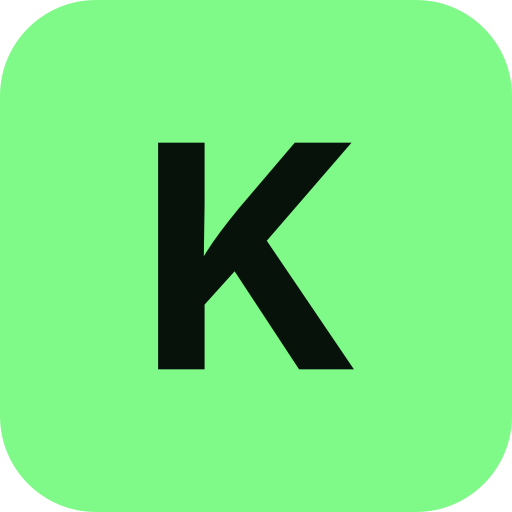

<p align="center"></p>

# Kove for your AI assistant

[Kove](https://kovejournal.com) is a private health journal: you say what you ate, how you trained and how you
slept, and Kove keeps the record on its own server in the EU. This repository connects Kove to the assistant you
already talk to (Claude, ChatGPT, Cursor, Grok Bot, or any MCP client) and teaches it to use Kove well.

Kove has a 30-day free trial, then costs 39 € a year or 4.99 € a month. Connecting an assistant is included.

## What you get

- **Say it where you already are.** "Pasta al pomodoro for lunch, about 80 g dry" in your assistant lands in
  your Kove journal.
- **Kove does the counting.** It looks each food up (its own food tables, packaged products by brand or barcode,
  the foods you saved), adds the day up and writes the journal line. Your assistant never does the arithmetic.
- **Anything you track.** Weight, sleep, water, a headache, magnesium, your waist. A new field is created only
  after you say yes.
- **Ask about your days.** Exact averages and totals, this week against last week, what you ate on the days you
  slept less.
- **Patterns that are tested.** Kove checks an idea against chance before anyone calls it a pattern, and says
  which ones hold.
- **Training.** Log your sets, read your history, build plans you run at the gym in the Kove app.
- **Undo for 7 days.** Every change your assistant makes shows up in Kove with an Undo.

## Try saying

- "Log lunch: pasta al pomodoro, about 80 g dry, and a side salad"
- "I weighed 78.4 this morning and drank another half litre of water"
- "Bench press today, 3 sets of 8 at 60 kg"
- "How did my sleep and training go this week, compared with the week before?"
- "Start tracking magnesium, I take 300 mg most evenings"

Your assistant replies in your language, and your journal keeps your own field names.

## Connect Kove

Kove's address for every assistant is:

```
https://app.kovejournal.com/mcp
```

The first time, your assistant opens Kove's sign-in. You sign in (or create an account) and choose what it may
do: read your journal, or read and write. Kove emails you when an assistant is connected, and Settings › Account
in the app lists every connection with Disconnect.

Use only this address, and sign in only on `app.kovejournal.com`. Kove never asks for your password in a chat.
The steps for each app are in the [setup guide](https://kovejournal.com/connect/).

### Ask your assistant to do it

Paste this into the assistant you use:

```
Connect Kove, my health journal (kovejournal.com), to this assistant.
Add a remote MCP server at https://app.kovejournal.com/mcp. It signs in with OAuth, so there is no key.
Use only that address. I will sign in on app.kovejournal.com myself; never ask me for my Kove password.
If you can install skills, install the Kove skills from https://github.com/kovejournal/kove-skills too.
Then tell me what you set up and what is left for me to do.
```

Some assistants can add the connection themselves; others tell you where to click. The steps for each are below.

### Claude Code

```
/plugin marketplace add kovejournal/kove-skills
/plugin install kove@kove
```

Then run `/mcp` and sign in to Kove. The plugin brings the connection and the skills together.

### Claude (web, desktop, mobile)

In Claude's settings, open Connectors, add a custom connector, and paste the address above. For the skills,
download the `skills/kove` folder as a zip and upload it in Claude's settings, under Skills.

### Cursor and Grok Bot

In Cursor, add an MCP server with the address above (Settings, MCP, or `~/.cursor/mcp.json`):

```json
{ "mcpServers": { "kove": { "url": "https://app.kovejournal.com/mcp" } } }
```

In Grok Bot, ask it to add an MCP server with the address. For the skills, see below.

### ChatGPT

Where your plan lets you add a custom connector, add one with the address above.

### Any other MCP client

Add a remote server (Streamable HTTP) with the address above. It signs in with OAuth, so there is no key to copy.

## The skills

They teach your assistant how Kove counts, how to correct and undo, when to ask you first, and how to talk about
your numbers (as facts, never as verdicts). One command installs them into Claude Code, Cursor, Codex and most
other agents:

```
npx skills add kovejournal/kove-skills
```

| Skill | What it is for |
|---|---|
| [`kove`](skills/kove/SKILL.md) | Everything day to day: logging food and anything else, workouts, corrections, undo, new fields, goals, reminders, looking back. |
| [`kove-weekly-review`](skills/kove-weekly-review/SKILL.md) | "How did my week go?": a short, exact review from Kove's own figures. |
| [`kove-training-plan`](skills/kove-training-plan/SKILL.md) | Building and adjusting training plans you run in the Kove app. |

The skills are plain text. Nothing in this repository runs on your computer.

## Your data

- Your record stays on Kove's server in the EU.
- What your assistant reads from Kove goes to the company that runs the assistant, under your agreement with
  them, and may be outside the EU. Whether they keep it or train on it depends on their terms and your settings.
- You choose read or read and write when you connect, and you can disconnect at any time. A password reset
  disconnects every assistant.
- Your assistant can ask for a full copy of your data. Nothing is sent until you approve it in the Kove app, each
  time, and your pictures go only if you tick them.
- Kove's [privacy policy](https://kovejournal.com/privacy/#assistant) and
  [terms](https://kovejournal.com/terms/) say what connecting an assistant means, in full.

Kove is a journal, not medical advice.

## Help

- Questions: hello@kovejournal.com, or the [FAQ](https://kovejournal.com/faq/).
- A skill that leads your assistant wrong: [open an issue](../../issues).
- Security: see [SECURITY.md](SECURITY.md).
- Contributing: see [CONTRIBUTING.md](CONTRIBUTING.md).

## License

The skills and manifests are under the [Apache License 2.0](LICENSE). The Kove name and logo are not covered by
it (see [NOTICE](NOTICE)): a fork may reuse the text, but not publish itself as Kove.
