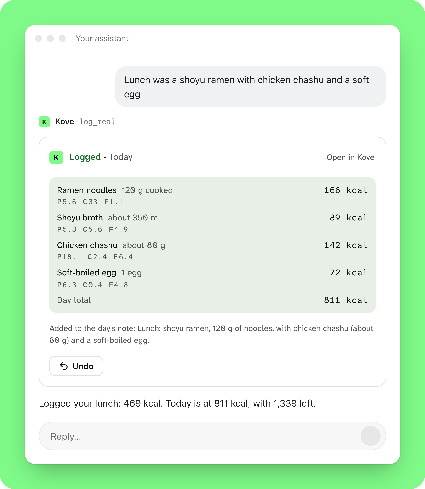
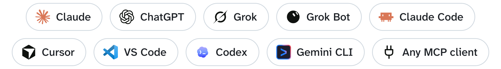
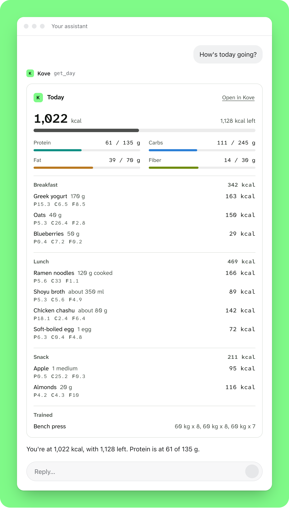
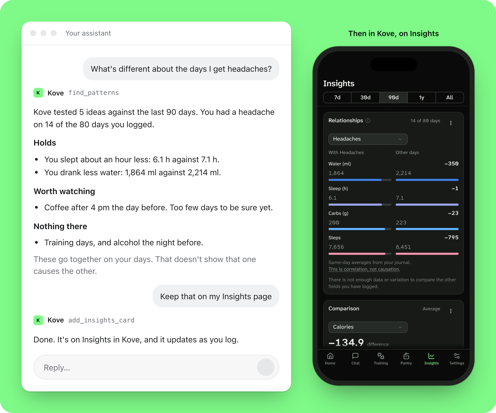

<p align="center">
  
</p>

<h1 align="center">Kove for your AI assistant</h1>

<p align="center">
  Your health journal, in the assistant you already use.<br>
  Tell Claude, ChatGPT, Grok or Cursor what you ate, how you trained and how you slept.<br>
  Kove does the counting, keeps the record and checks what goes with what.
</p>

<p align="center">
  <a href="https://kovejournal.com/connect/"><b>Setup guide</b></a>
  &nbsp;·&nbsp;
  <a href="https://kovejournal.com">kovejournal.com</a>
  &nbsp;·&nbsp;
  <a href="https://kovejournal.com/faq/">Questions</a>
  &nbsp;·&nbsp;
  <a href="https://kovejournal.com/privacy/#assistant">Privacy</a>
</p>

<p align="center">
  <picture>
    <source media="(prefers-color-scheme: dark)" srcset="assets/log-meal-dark.png">
    
  </picture>
</p>

## Connect Kove in one message

Paste this into your assistant:

```text
Set up Kove: add the remote MCP server https://app.kovejournal.com/mcp
```

Your assistant adds Kove and opens Kove's sign-in in your browser. Sign in or create an account, press **Allow**,
and you're set. There is no key to paste, and the first 30 days are free.

If your assistant can't change its own settings, add the address yourself as a custom connector or MCP server.
The [steps for each app](#add-kove-to-your-app) are below.

```text
https://app.kovejournal.com/mcp
```

<p align="center">
  <picture>
    <source media="(prefers-color-scheme: dark)" srcset="assets/works-with-dark.png">
    
  </picture>
</p>

## What to say

The way you would tell a friend, in any language:

- "Lunch was a shoyu ramen with chicken chashu and a soft egg"
- "I weighed 78.4 this morning and drank another half litre of water"
- "Bench press today, 3 sets of 8 at 60 kg"
- "How's today going?"
- "How did my sleep and training go this week, compared with the week before?"
- "What's different about the days I get headaches?"
- "Start tracking magnesium, I take 300 mg most evenings"
- "Undo what you logged this morning"

Your assistant answers in your language, and your journal keeps your own field names.

<p align="center">
  <picture>
    <source media="(prefers-color-scheme: dark)" srcset="assets/your-day-dark.png">
    
  </picture>
</p>

## Find what goes with what

Ask what's different about the days you get headaches, or whether you sleep worse after a late dinner. Left
alone, an assistant will find a pattern in anything, and tell you about it with total confidence.

Kove checks before anyone calls it a pattern. Your assistant suggests what to look at, Kove tests each idea
against your own days and against chance, and you hear which ones hold. Kove also looks by itself, across
everything you track, including the day before and the day after.

<p align="center">
  <picture>
    <source media="(prefers-color-scheme: dark)" srcset="assets/patterns-dark.png">
    
  </picture>
</p>

A pattern means two kinds of days that differ. It doesn't mean one causes the other, and Kove never says it
does. On a short record Kove is careful, and the longer you log, the more it can tell you. The patterns you want
to follow stay on your Insights page in Kove.

## Why Kove, and not just your assistant

Your assistant is good at understanding what you say. It is not a good place to keep a record: ask it twice how
many calories are in a plate of pasta and you may get two answers, and a chat is not something you can look back
on. Kove is the part that keeps the numbers straight.

- **The numbers are Kove's.** It looks up each food in its own food tables, packaged products by brand or
  barcode, and the foods you saved, then adds up the day. Your assistant never does the math, and Kove
  [measures how close it gets](https://kovejournal.com/accuracy/) in public.
- **It keeps everything, exactly.** Every day you log stays in Kove. Ask for an average, a total or this week
  against last, and Kove works out the exact figure.
- **Anything you track.** Weight, sleep, water, a headache, magnesium, your waist. Kove adds a new field only
  after you say yes.
- **Training.** Log your sets, read your history, and build plans you run at the gym in the Kove app.
- **Nothing grades you.** Kove states your numbers as facts. It keeps no streaks and never calls a day good or
  bad.
- **Undo for 7 days.** Every change your assistant makes shows up in Kove, with Undo.

## Add Kove to your app

Every app uses the same address, `https://app.kovejournal.com/mcp`, and signs in with OAuth. The first time, Kove
opens in your browser: sign in, choose **Read and write** or **Read only** if it asks, and press **Allow**.

Sign in only on `app.kovejournal.com`. Kove never asks for your password in a chat.

### Claude

On claude.ai or in the desktop app, open **Customize**, then **Connectors** (in older versions, under Settings).
Click **+ Add**, then **Add custom connector**, name it Kove and paste the address. In a chat, turn Kove on from
the **+** menu. Once it's added, it works in the phone app too.

### ChatGPT

On a Business, Enterprise or Edu workspace, open **Plugins** on chatgpt.com, click **+**, then **Add custom MCP
server**. Name it Kove, paste the address as the Server URL, choose **OAuth**, then **I understand and want to
continue** and **Create as a plugin**. On Pro a custom server can only read, and Plus, Go and the free plan can't add one.

### Grok

On [grok.com/connectors](https://grok.com/connectors), click **New Connector**, then **Custom**, paste the address
and sign in.

### Grok Bot

Ask it in a chat to add the MCP server at Kove's address, then sign in and press **Allow**. Grok Bot connects
through Cursor, so Kove's Allow screen names Cursor.

### Claude Code

The plugin brings Kove and its skills together:

```text
/plugin marketplace add kovejournal/kove-skills
/plugin install kove@kove
```

Then run `/mcp`, pick Kove and sign in.

### Cursor

[Add Kove to Cursor](https://cursor.com/install-mcp?name=Kove&config=eyJ1cmwiOiJodHRwczovL2FwcC5rb3Zlam91cm5hbC5jb20vbWNwIn0=)
in one click, or add this to `~/.cursor/mcp.json`:

```json
{
  "mcpServers": {
    "kove": { "url": "https://app.kovejournal.com/mcp" }
  }
}
```

### VS Code

In GitHub Copilot's agent mode:
[Add Kove to VS Code](https://vscode.dev/redirect/mcp/install?name=kove&config=%7B%22type%22%3A%22http%22%2C%22url%22%3A%22https%3A%2F%2Fapp.kovejournal.com%2Fmcp%22%7D)
in one click, or run **MCP: Add Server** from the Command Palette, choose **HTTP** and paste the address.

### Codex

```text
codex mcp add kove --url https://app.kovejournal.com/mcp
```

If Codex doesn't open Kove's sign-in by itself, run `codex mcp login kove`.

### Gemini CLI

```text
gemini mcp add --transport http kove https://app.kovejournal.com/mcp
```

Then run `/mcp auth kove` in Gemini CLI and sign in.

### Any other MCP client

Add a remote server (Streamable HTTP) at Kove's address. It signs in with OAuth, so there is no key or token to
paste.

## The skills

Kove works without them. With them, your assistant knows how Kove counts, how to correct and undo, when to ask you
first, and how to talk about your numbers: as facts, never as verdicts. In Claude Code the plugin above brings
them. In Cursor, Codex, Gemini CLI and most other agents:

```text
npx skills add kovejournal/kove-skills
```

| Skill | What it is for |
|---|---|
| [`kove`](skills/kove/SKILL.md) | Everything day to day: logging food and anything else, workouts, corrections, undo, new fields, goals, reminders, looking back. |
| [`kove-weekly-review`](skills/kove-weekly-review/SKILL.md) | "How did my week go?": a short, exact review from Kove's own figures. |
| [`kove-training-plan`](skills/kove-training-plan/SKILL.md) | Building and adjusting training plans you run in the Kove app. |

In the Claude app, you can also download the `skills/kove` folder as a zip and upload it in Settings, under
Skills. The skills are plain text: nothing in this repository runs on your computer.

## Your data

- Your record stays on Kove's server in the EU.
- What your assistant reads from Kove goes to the company that runs the assistant, under your agreement with
  them, and may be outside the EU. Whether they keep it or train on it depends on their terms and your settings.
- You choose read or read and write when you connect. Kove emails you when an assistant is connected, and
  Settings › Account in the app lists every connection with Disconnect. A password reset disconnects every
  assistant.
- Your assistant can ask for a full copy of your data. Nothing is sent until you approve it in the Kove app, each
  time, and your pictures go only if you tick them.
- Kove's [privacy policy](https://kovejournal.com/privacy/#assistant) and
  [terms](https://kovejournal.com/terms/) say what connecting an assistant means, in full.

Kove is a journal, not medical advice.

## Price

Kove is free for 30 days, then 39 € a year or 4.99 € a month. Connecting an assistant is included.
[Try Kove](https://kovejournal.com).

## Help

- Questions: hello@kovejournal.com, or the [FAQ](https://kovejournal.com/faq/).
- A skill that leads your assistant wrong: [open an issue](https://github.com/kovejournal/kove-skills/issues).
- Security: see [SECURITY.md](SECURITY.md).
- Contributing: see [CONTRIBUTING.md](CONTRIBUTING.md).

## License

The skills and manifests are under the [Apache License 2.0](LICENSE). The Kove name and logo are not covered by
it (see [NOTICE](NOTICE)): a fork may reuse the text, but not publish itself as Kove. The app logos in
`assets/works-with-*.png` belong to their makers and are shown only to say Kove works with them.
